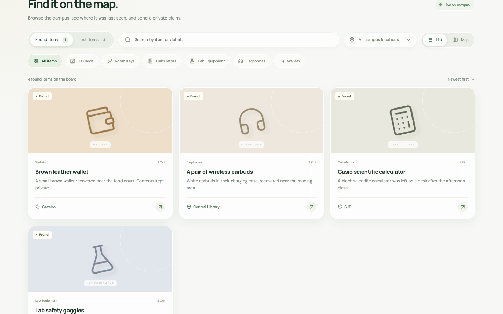

# reunite. — campus lost & found for VIT Vellore

Reunite is a full-stack lost-and-found board for the VIT Vellore campus. Anyone can browse lost and
found reports across 42 campus venues; only verified VIT students can post, claim, and message. When
someone reports "this is mine", the finder privately verifies the claim with an expected-answer hint
and an optional proof photo, then the two parties finish the handoff in a private thread with
proposable meetups at campus checkpoints. The reporter's identity never appears on the public board,
and no phone numbers or emails can be planted in public text — the point is a safe handoff, not a
classifieds page.



## Features

- **Lost and found feeds** with search, category, venue and kind filters, plus a campus **map view**
  (see [The map: three tiers](#the-map-three-tiers)).
- **42 campus venues** and **6 categories** (ID Cards, Room Keys, Calculators, Lab Equipment,
  Earphones, Wallets) with curated coordinates and **7 checkpoint locations** for safe meetups.
- **Private claim verification**: a claim sends the finder a verification answer (10–1500 chars) and
  an optional proof photo that only the two parties can view.
- **Finder expected-answer hint**: when reporting, the finder records what only the true owner would
  know; claim answers are compared against it with match guidance.
- **Anonymous public board**: public item data is a fixed field list — no names, emails, or
  registration numbers, ever.
- **Private handoff threads** (only after claim approval) with unread badges, and **meetup
  propose / accept / decline / counter** with time and checkpoint.
- **Cancel handoff**: either party can cancel, returning the claim to rejected and the item to the
  board.
- **Edit or delete your own report**; the **reporter resolves** an item as returned.
- **Notifications summary** endpoint polled for a header badge (pending claims, meetup responses,
  unread messages).
- **Listing abuse reports** with an **admin moderation** view for `ADMIN_EMAILS`.
- **Password reset** with single-use tokens, rate limiting, and no account enumeration.
- **Expanded PII detection** rejects phone numbers, emails and registration numbers in public text
  and thread messages; search input is escaped before SQL `LIKE`.
- **Photo upload with metadata stripping**: images are re-encoded to WebP with sharp, dropping EXIF
  and any embedded location data.

## Prerequisites

- **Node.js 24 recommended; 22.13 minimum** (enforced by `server/preflight.js`, which prints a
  friendly message instead of a module crash). The repo ships an `.nvmrc`.
- npm (bundled with Node). No external database — everything lives in SQLite.

## Quick start

macOS / Linux:

```sh
npm ci
cp .env.example .env
npm run db:init
npm run db:seed
npm run dev
```

Windows PowerShell:

```powershell
npm ci
Copy-Item .env.example .env
npm run db:init
npm run db:seed
npm run dev
```

Then open **http://localhost:5173** — the Vite dev server proxies `/api` to the API on port 8080.

Production-style run (single process serving the built client and the API):

```sh
npm run build
npm start          # http://127.0.0.1:8080 by default
```

`npm run doctor` checks Node, env, uploads dir and the optional Mapbox token, and prints what to fix.

## Database bootstrap

All state lives in `data/` (gitignored): `reunite.sqlite` (with `-wal`/`-shm` side files) and
`data/uploads/` for re-encoded photos.

| Script             | What it does                                                                                                                 |
| ------------------ | ---------------------------------------------------------------------------------------------------------------------------- |
| `npm run db:init`  | Creates the data directory, opens the SQLite database and applies `server/migrations/*.sql` in order (scripts/bootstrap.js). |
| `npm run db:seed`  | Inserts two demo accounts and six sample reports (scripts/seed.js). Refuses to run in production.                            |
| `npm run db:reset` | Deletes `reunite.sqlite` (+ side files), re-applies migrations (scripts/reset.js). Uploads are left alone.                   |

Migrations are applied automatically by `server/db.js` **on every server start** as well: each
numbered `.sql` file runs inside a transaction and is recorded in a `schema_migrations` table, so
re-runs are no-ops. To start clean:

```sh
npm run db:reset    # fresh empty schema
npm run db:seed     # optional demo data
```

## Environment variables

Everything is validated at startup by `server/config.js` (Zod). Copy `.env.example` to `.env` and
adjust — none of these are secrets baked into the repo.

| Variable                   | Default                                                  | Production                        | Purpose                                                                                                                                               |
| -------------------------- | -------------------------------------------------------- | --------------------------------- | ----------------------------------------------------------------------------------------------------------------------------------------------------- |
| `NODE_ENV`                 | `development`                                            | set `production`                  | Enables production rules (see two rows below).                                                                                                        |
| `PORT`                     | `8080`                                                   | —                                 | Port for the API and the built client.                                                                                                                |
| `HOST`                     | `127.0.0.1` in development/test, `0.0.0.0` in production | —                                 | Bind address. Loopback by default so the dev server is not exposed on the LAN; `dev:lan` sets `0.0.0.0` on purpose (trade-off documented below).      |
| `APP_ORIGIN`               | `http://localhost:5173`                                  | set your public URL               | Trusted web origin checked by `server/middleware/origin.js`; also used in email links.                                                                |
| `DATABASE_PATH`            | `./data/reunite.sqlite`                                  | —                                 | SQLite database file (`:memory:` supported for tests).                                                                                                |
| `UPLOADS_DIR`              | `./data/uploads`                                         | —                                 | Where re-encoded WebP photos are stored.                                                                                                              |
| `VITE_MAPBOX_ACCESS_TOKEN` | unset                                                    | —                                 | Optional Mapbox token enabling the Tier-1 basemap. Baked into the client bundle at build time — treat it as public and restrict it (see map section). |
| `SMTP_HOST`                | unset                                                    | **required**                      | SMTP server for verification / reset email. Startup fails without it in production.                                                                   |
| `SMTP_PORT`                | `587`                                                    | —                                 | SMTP port.                                                                                                                                            |
| `SMTP_USER` / `SMTP_PASS`  | unset                                                    | recommended                       | SMTP credentials.                                                                                                                                     |
| `SMTP_FROM`                | `VIT Reunite <no-reply@vitstudent.ac.in>`                | —                                 | From header for outgoing mail.                                                                                                                        |
| `ADMIN_EMAILS`             | empty                                                    | —                                 | Comma-separated emails whose accounts get the Moderation view.                                                                                        |
| `DEV_AUTO_VERIFY`          | `false`                                                  | **forbidden**                     | Auto-approves email verification in development. Startup refuses it in production.                                                                    |
| `TRUST_PROXY`              | `false`                                                  | set `true` behind a reverse proxy | Honors `X-Forwarded-For` so rate limiting sees real client IPs.                                                                                       |

### HOST and `dev:lan` trade-off

By default the dev API listens on `127.0.0.1` only, so nobody else on the Wi-Fi can reach it.
`npm run dev:lan` deliberately binds the backend to `0.0.0.0` (via scripts/dev-backend.js) and
starts Vite with `--host` so a phone on the same network can use the app — run `node scripts/print-lan.js`
to get the URL to open. That convenience means anyone on your LAN can reach your dev instance: use
it only on trusted networks. The Origin allow-list still applies; to test from another device,
`APP_ORIGIN` must include that LAN URL.

## Demo accounts and a 2-minute walkthrough

`npm run db:seed` creates (development only — the sign-in dialog prints these too):

| Account | Email                      | Password          |
| ------- | -------------------------- | ----------------- |
| Finder  | `finder@vitstudent.ac.in`  | `CampusDemo2026!` |
| Student | `student@vitstudent.ac.in` | `CampusDemo2026!` |

The walkthrough (≈2 minutes):

1. **Sign in as the finder**, press **Report an item**, pick a category and venue, describe it, and
   set the **private expected answer** — a detail only the true owner could match. The item appears
   on the board.
2. **Sign out, sign in as the student**, open the item, press **This is mine**, type your
   verification answer (optionally attach a proof photo) and send the request.
3. **Back as the finder**, the **My activity** nav shows a badge. Open the claim, compare the answer
   with your hint, and press **Approve**. The item moves to handoff and other pending claims are
   auto-rejected.
4. **Private handoff thread** opens for both parties. Send a message, **propose a meetup** (time +
   checkpoint); the student accepts (or counters).
5. After the physical handoff, the finder presses **Mark returned** and confirms — the item leaves
   the board and the reunited counter on the board ticks up.

## The map: three tiers

The map view (MapboxMap.jsx) degrades gracefully instead of going blank:

1. **Mapbox GL** — used only when `VITE_MAPBOX_ACCESS_TOKEN` is set **and** the token verifies
   against the Mapbox API (invalid/restricted tokens fall through, never hang the UI).
2. **Keyless vector map** — MapLibre GL with the free OpenFreeMap "Liberty" style. No token, no
   account. This is what you get by default.
3. **Offline schematic** — a hand-drawn campus diagram with venue pins, used when vector tiles
   cannot load (blocked network, offline). A tier chip in the corner always says which tier is
   active.

**The repo does not ship a Mapbox token.** If you want Tier 1: create a token at
<https://account.mapbox.com/access-tokens/>, restrict it to the URLs you will serve the app from,
put it **only** in your local `.env` as `VITE_MAPBOX_ACCESS_TOKEN`, and run `npm run build` again.
Because the token is embedded in the client bundle, keep it URL-restricted and never commit `.env`.
`npm run doctor` warns when the token is missing or still the `.env.example` placeholder and says the
app will use the free map fallback.

## Requirements traceability

Each row: requirement → where it is implemented → the test that proves it (all names are real, from
`tests/` and `e2e/`).

| Requirement                                                 | Implementation                                      | Test                                                                                      |
| ----------------------------------------------------------- | --------------------------------------------------- | ----------------------------------------------------------------------------------------- |
| Venue coordinates, validation, nearest checkpoint           | server/venues.js, client/src/lib/campus.js          | `G-2: Venue coordinates default, validation, and nearest checkpoint`                      |
| Cancel handoff returns claim to rejected, item to active    | server/routes/claims.js                             | `G-3: Cancel handoff returns claim to rejected and item to active`                        |
| Owner edits/deletes own report, authorization boundaries    | server/routes/items.js                              | `G-4: Owner edit and delete report with authorization boundaries`                         |
| Meetup propose → accept / decline / counter state machine   | server/routes/claims.js                             | `G-6: Meetup state machine (propose -> accept/decline/counter)`                           |
| Notifications summary reflects pending activity             | server/routes/notifications.js                      | `G-7: Notifications summary endpoint reflects pending activity`                           |
| Expected-answer hint private to finder, match guidance      | server/lib/privacy.js, server/routes/claims.js      | `G-8: Expected answer hint is private to finder and matches guidance`                     |
| Abuse reporting + admin moderation endpoints                | server/routes/items.js, server/routes/admin.js      | `G-9: Listing abuse report and admin moderation endpoints`                                |
| Password reset: single use, rate limited, no enumeration    | server/routes/auth.js                               | `G-10: Password reset (single use, rate limited, no enumeration)`                         |
| Expanded PII detection + `LIKE` escaping                    | server/lib/privacy.js                               | `G-11: Expanded PII detection (spaced numbers, words, handles, LIKE escape)`              |
| Full private recovery lifecycle + authorization             | server/routes/*                                     | `complete private recovery lifecycle and authorization boundaries`                        |
| Report photo public; proof photo restricted to both parties | server/lib/photos.js, server/routes/claims.js       | `report photo is public and ownership proof stays restricted to both parties`             |
| Validation, anonymity, origin protection                    | server/middleware/origin.js, server/routes/items.js | `validation, anonymity and origin protection`                                             |
| Reject workflow; reporter resolves item                     | server/routes/claims.js, server/routes/items.js     | `reject workflow and reporter resolution`                                                 |
| Email verification gates sign-in; tokens single use         | server/routes/auth.js                               | `student email verification gates sign-in and tokens are one use`                         |
| Origin allow-list: loopback ports ok, external rejected     | server/middleware/origin.js                         | `development permits alternate loopback ports and rejects external or missing origins`    |
| Refuse unsupported Node runtimes with a clear message       | server/preflight.js                                 | `preflight accepts Node >= 22.13 and rejects older runtimes`                              |
| Board loads seeded items; empty state after filtering       | client/src/main.jsx                                 | e2e: `board loads with seeded items and shows the empty state after filtering to nothing` |
| Map never blank when Mapbox is unreachable                  | client/src/MapboxMap.jsx                            | e2e: `map never ends blank when Mapbox hosts are blocked`                                 |
| Golden path: claim → approve → message → returned           | client + server                                     | e2e: `golden path: claim, approve, message, mark returned, item leaves the board`         |
| Claimant never receives finder identity                     | server/routes/*                                     | e2e: `claimant session never receives finder identity in responses or page text`          |

## API reference

All endpoints are under `/api`, JSON only, and guarded by an Origin allow-list. Auth = httpOnly
session cookie.

| Method & path                                                      | Auth     | Purpose                                                                            |
| ------------------------------------------------------------------ | -------- | ---------------------------------------------------------------------------------- |
| `POST /api/auth/register`                                          | –        | Register with a `@vitstudent.ac.in` / `@vit.ac.in` email; sends verification mail. |
| `POST /api/auth/verify`                                            | –        | Consume a one-use email verification token.                                        |
| `POST /api/auth/resend-verification`                               | –        | Re-send the verification email (rate limited).                                     |
| `POST /api/auth/login` / `POST /api/auth/logout`                   | –        | Sign in / sign out (rate limited).                                                 |
| `GET /api/auth/me`                                                 | ✓        | Current user (or `null`).                                                          |
| `POST /api/auth/forgot-password` / `POST /api/auth/reset-password` | –        | Single-use reset tokens, rate limited, no enumeration.                             |
| `GET /api/items`                                                   | –        | Board feed with `kind`, `category`, `venue`, `search`, pagination.                 |
| `GET /api/map/items`                                               | –        | Same filters, coordinates for the map view.                                        |
| `GET /api/stats`                                                   | –        | Board counters (active reports, reunited, venues).                                 |
| `POST /api/items`                                                  | ✓        | Create report, optional photo (multipart), private expected answer.                |
| `GET /api/items/:id` / `GET /api/items/:id/photo`                  | –        | Public detail + photo (fixed public field list).                                   |
| `PATCH /api/items/:id` / `DELETE /api/items/:id`                   | owner    | Edit / delete your own report.                                                     |
| `POST /api/items/:id/resolve`                                      | owner    | Mark the item returned; leaves the board.                                          |
| `POST /api/items/:id/reports`                                      | ✓        | Report a listing for moderation.                                                   |
| `POST /api/items/:id/claims`                                       | ✓        | Submit a private claim: verification answer + optional proof photo.                |
| `GET /api/claims/:id/proof-photo`                                  | parties  | Proof photo, restricted to reporter + claimant.                                    |
| `PATCH /api/claims/:id`                                            | reporter | Approve / reject the claim (approval opens the thread, auto-rejects rivals).       |
| `POST /api/claims/:id/cancel-handoff`                              | parties  | Cancel an active handoff (G-3).                                                    |
| `PATCH /api/claims/:id/meetup`                                     | parties  | Propose or counter a meetup (time + checkpoint).                                   |
| `POST /api/claims/:id/meetup/accept` / `.../decline`               | parties  | Respond to a proposal.                                                             |
| `GET /api/dashboard`                                               | ✓        | My reports, my claims, and their statuses in one call.                             |
| `GET /api/claims/:id/thread` / `POST /api/claims/:id/messages`     | parties  | Private handoff thread (PII-scanned messages).                                     |
| `GET /api/notifications/summary`                                   | ✓        | Badge counts: pending claims, meetup responses, unread messages.                   |
| `GET /api/admin/reports` / `DELETE /api/admin/items/:id`           | admin    | Moderation queue and takedown.                                                     |
| `GET /api/health`                                                  | –        | Liveness probe used by CI and e2e.                                                 |

## Privacy model, in plain language

1. **Campus identity is verified.** Registration only accepts `@vitstudent.ac.in` / `@vit.ac.in`
   addresses, and sign-in stays locked until the emailed link is clicked. Tokens are single use.
   (`DEV_AUTO_VERIFY=true` skips this in development only; production startup refuses it.)
2. **The public board is anonymous.** Public item responses are assembled from a fixed field list in
   server/routes/items.js — the reporter's name, email and registration number are simply never
   selected.
3. **Verification instead of exposure.** A claim sends a private answer and optional proof photo (an
   endpoint only the two parties can call). While a claim is pending, the claimant receives no trace
   of the finder's identity anywhere in API responses or page text.
4. **A private room, not a public comment box.** Messaging exists only inside an approved two-party
   thread. Messages and public reports are scanned by server/lib/privacy.js, which rejects phone
   numbers, email addresses and registration-style IDs before they are stored.
5. **Photos are sanitized.** Uploads are re-encoded to WebP with sharp, stripping EXIF metadata
   (including GPS tags) before anything is written to disk.
6. **Sessions are unguessable.** Login issues a random token stored hashed in SQLite and sent as an
   httpOnly cookie; passwords use bcrypt; auth and claim endpoints are rate limited.

## Project structure

```
vit-reunite/
├── server/               # Express 5 API (node:sqlite)
│   ├── index.js          # Entry: preflight Node check, then binds HOST:PORT
│   ├── app.js            # Helmet/CSP, origin allow-list, routes, static client
│   ├── config.js         # Zod-validated environment
│   ├── db.js             # SQLite setup + migration runner
│   ├── preflight.js      # Node >= 22.13 check (imported before everything)
│   ├── routes/           # auth, items, claims, threads, notifications, admin
│   ├── middleware/       # auth (sessions), origin (allow-list), errors
│   ├── lib/              # mailer, photos (sharp re-encode), privacy (PII)
│   └── migrations/       # numbered .sql files, applied in order
├── client/               # React 19 + Vite 7 workspace
│   └── src/
│       ├── main.jsx      # Whole app: board, report, dashboard, threads, admin
│       ├── MapboxMap.jsx # Tiered map: Mapbox → MapLibre → offline schematic
│       ├── features/map/ # OfflineCampusMap.jsx (tier 3)
│       ├── lib/          # campus.js (venues/checkpoints), theme.js
│       └── styles.css    # Design tokens incl. dark theme
├── scripts/              # bootstrap, seed, reset, doctor, dev-backend, print-lan
├── tests/                # 16 node:test integration tests (supertest)
├── e2e/                  # 4 Playwright specs (real browser, real server)
├── docs/                 # screenshots (docs/screens/) + VALIDATION.md
└── data/                 # gitignored runtime state (sqlite, uploads)
```

## Scripts

| Command                                    | What it does                                                                    |
| ------------------------------------------ | ------------------------------------------------------------------------------- |
| `npm run dev`                              | API with `node --watch` + Vite dev server (loopback only).                      |
| `npm run dev:lan`                          | Same, but the API binds `0.0.0.0` and Vite uses `--host` (see trade-off above). |
| `npm start`                                | Serve API + built client from one process (`PORT`, `HOST`).                     |
| `npm run build`                            | Build the client into `client/dist`.                                            |
| `npm test`                                 | 16 integration tests (`node --test` + supertest).                               |
| `npm run test:e2e`                         | Playwright suite. Run `npm run build` first — it boots the built app.           |
| `npm run lint`                             | ESLint (flat config, `eslint:recommended` + react-hooks rules).                 |
| `npm run format` / `npm run format:check`  | Prettier write / check (printWidth 100, single quotes).                         |
| `npm run doctor`                           | Environment check: Node, config, dirs, optional Mapbox token.                   |
| `npm run db:init` / `db:seed` / `db:reset` | Database bootstrap (see above).                                                 |

## CI

`.github/workflows/ci.yml` runs on Node 24 / Ubuntu: `npm ci` → `format:check` → `lint` → `test` →
`build` → Playwright with Chromium → `test:e2e`. Failed e2e runs upload the Playwright report as an
artifact.

## Deployment notes

- Set `NODE_ENV=production`, a real `APP_ORIGIN`, and `SMTP_HOST` (+ credentials). The server
  refuses to start otherwise (and refuses `DEV_AUTO_VERIFY=true`).
- Behind a reverse proxy set `TRUST_PROXY=true` so rate limits see real client IPs; keep `HOST=0.0.0.0`
  (the production default) if the proxy runs on another host/container.
- One process serves everything: `npm run build && npm start`. The Express app serves `client/dist`
  and the API on the same port, with Helmet CSP.
- `data/` must be a persistent volume (SQLite + uploaded photos). Back up `reunite.sqlite` and
  `uploads/`.
- To rotate the Mapbox token, change `.env` and rebuild — the old token stays baked into any existing
  `client/dist` output until you rebuild.

## Troubleshooting

- **`Error: Node.js vXX is not supported`** — install Node ≥ 22.13 (`.nvmrc` pins 24 for nvm users).
- **Port already in use** — `PORT=3000 npm start`, or stop the other process.
- **"Use your VIT student email."** — registration only accepts `@vitstudent.ac.in` / `@vit.ac.in`.
- **Verification or reset email never arrives** — SMTP is not configured (`npm run doctor`). In
  development you can set `DEV_AUTO_VERIFY=true` instead.
- **Map looks schematic / "Schematic" chip** — that is the offline tier: no `VITE_MAPBOX_ACCESS_TOKEN`
  or blocked network. Everything still works; add a restricted token for vector maps.
- **Phone on the LAN cannot reach the dev server** — run `npm run dev:lan` (not `dev`), open the URL
  printed by `node scripts/print-lan.js`, and add that origin to `APP_ORIGIN`.
- **e2e tests fail to connect** — run `npm run build` first; `npm start` serves the built client.
- **Fresh start** — `npm run db:reset` wipes reports and accounts (uploads stay on disk).

## Security notes

- Never commit `.env`; `.env.example` contains placeholders only. The Vite build embeds
  `VITE_MAPBOX_ACCESS_TOKEN` into `client/dist` — restrict the token by URL and rotate it if it ever
  leaks.
- If you discover a security issue, please open a private security advisory via GitHub rather than a
  public issue.

## Licence

[MIT](LICENSE) © 2026 Reunite contributors.
